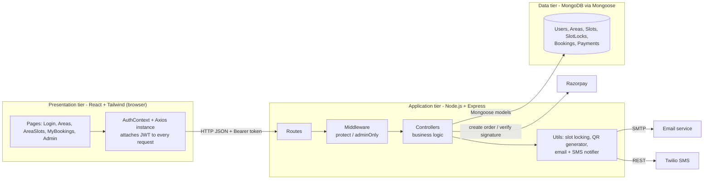
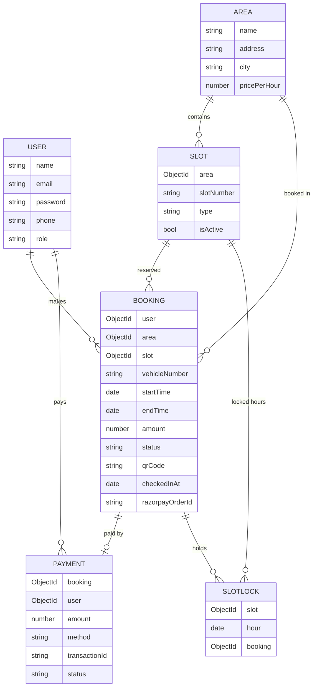
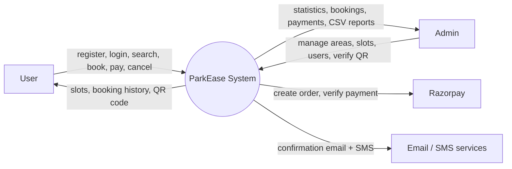
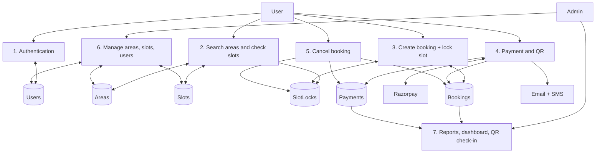
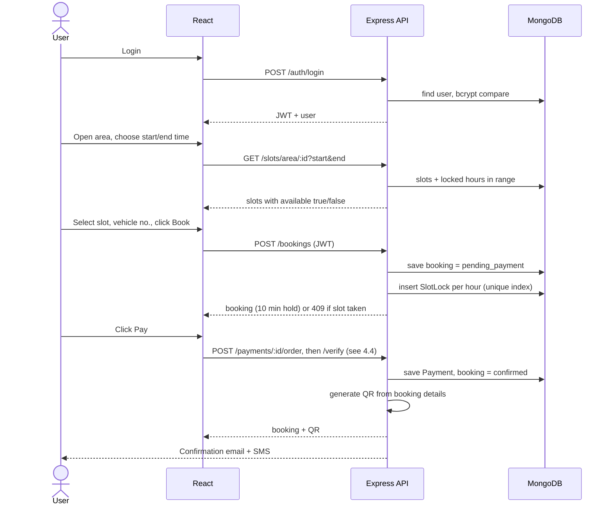
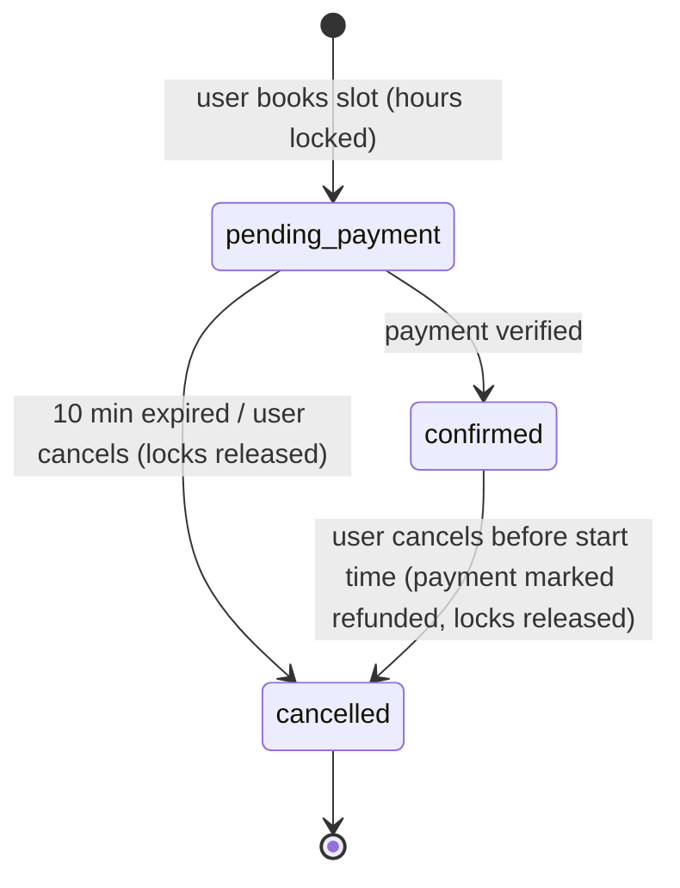
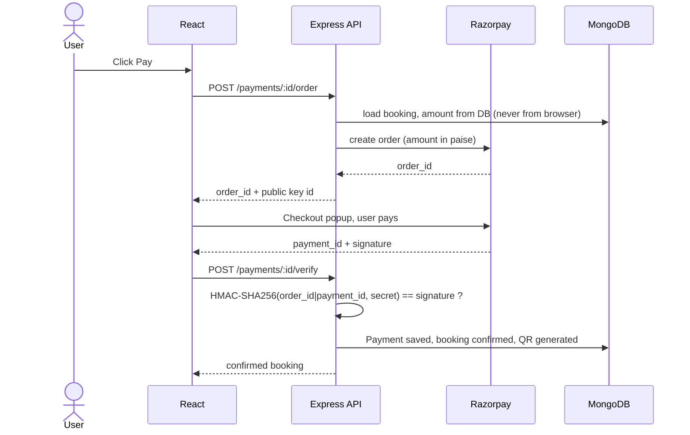
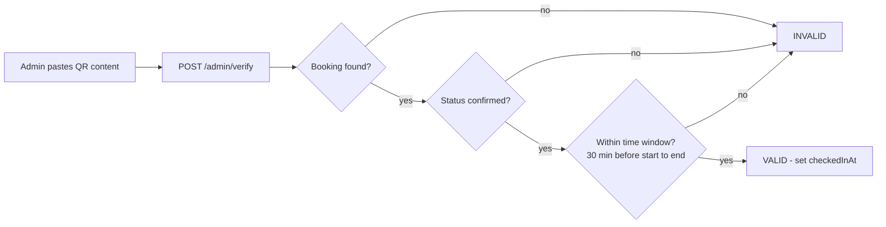

# ParkEase – Design Documentation

(Open in VS Code Markdown Preview or GitHub to see the diagrams.)

## 1. Architecture

**Style:** 3-tier client–server architecture, REST API, stateless authentication (JWT). The backend follows MVC: Routes -> Middleware -> Controllers -> Models.

| Layer | Responsibility |
|---|---|
| React pages | UI and form handling only, no business rules |
| Axios + AuthContext | Stores the JWT, sends it in `Authorization: Bearer`, keeps login state |
| Routes | Map URL + HTTP method to a controller and decide which middleware protects it |
| Middleware | `protect` verifies the JWT; `adminOnly` checks role |
| Controllers | All business rules (locking, price, payment verification, check-in) |
| Models | Schema, validation, DB access |

**Why this design:** separation of concerns (UI / logic / data), so each part can change independently. All rules are enforced on the server, because the client can never be trusted.

## 2. Database design (ER diagram)

- Relations are ObjectId references (like foreign keys), resolved with `populate()`.
- A slot has no `isBooked` flag. Availability depends on the time range: one `SlotLock` document exists per slot per booked hour, so a slot can be booked many times at different hours.
- `SlotLock` has a **unique index (slot + hour)**. This makes double booking impossible at database level (section 5).
- `Slot` has a unique index (area + slotNumber); `User.email` is unique; passwords are stored only as bcrypt hashes.

## 3. Data flow diagrams

### Level 0 (context)

### Level 1 (main processes and data stores)

## 4. Workflow

### 4.1 Main booking workflow

### 4.2 Booking status lifecycle

### 4.3 Authentication and authorization flow
1. Register: input validated, password hashed with bcrypt, role forced to `user` (admin only via seed/DB).
2. Login: server verifies the hash and returns a JWT (`{id}`, 7 days) signed with `JWT_SECRET`.
3. React saves the token in localStorage; the Axios interceptor adds it to every request.
4. `protect` middleware verifies the token and loads the user; `adminOnly` checks `role === 'admin'`.
5. React `Guard` hides pages for UX only. The real protection is the server middleware.

### 4.4 Payment workflow (Razorpay, test mode)

The browser only receives the public key id; the secret stays on the server. The booking is confirmed **only** after the signature check. If no Razorpay keys are set, the app runs in demo mode (`/simulate`), which is automatically disabled once keys exist.

### 4.5 QR check-in workflow

## 5. Key logic to explain

**Double-booking prevention (slot locks).**
1. The requested time is rounded outward to whole hours (10:30-11:15 becomes 10:00-12:00). Booking granularity is 1 hour.
2. The server creates the booking as `pending_payment`, then inserts one `SlotLock` document per hour: `{slot, hour, booking}`.
3. `SlotLock` has a **unique index on (slot, hour)**. If two users try the same hour at the same moment, MongoDB accepts one insert and rejects the other with duplicate-key error 11000. The loser gets HTTP 409 "Slot already booked" and their booking is deleted; any partial locks are rolled back.
4. Cancelling or expiring a booking deletes its locks, so the slot becomes free.
5. The slot grid uses the same locks: a slot is "Booked" if any lock exists for the requested hours (`utils/availability.js`).

Why not "check then insert"? Two requests can both pass the check and then both insert. A unique index turns the decision into one atomic database operation. MongoDB transactions would also work, but need a replica set, which a plain local MongoDB does not have.

**Price:** `hours x area.pricePerHour`, calculated on the server.

**Unpaid hold and auto-expiry:** an unpaid booking holds the slot for 10 minutes. A job runs every minute (and before each availability check and "my bookings" load) that cancels unpaid bookings older than that and deletes their locks.

**Notifications:** `utils/notify.js` sends email (Nodemailer) and SMS (Twilio REST API) together. Failures are swallowed, so a failed notification never breaks a booking. Without credentials both are printed in the console.

**QR code:** generated after payment with the `qrcode` library. It encodes booking id, area, slot, vehicle and times as JSON and is stored as a base64 image in the booking.

**Reports:** `GET /admin/report` builds a CSV (bookings or payments, optional date range) that the browser downloads.

**Dashboard:** `countDocuments` and `aggregate` ($group, $lookup) for totals, revenue and confirmed bookings per area.

## 6. REST API

| Method | Endpoint | Access | Purpose |
|---|---|---|---|
| POST | /api/auth/register | public | Register user |
| POST | /api/auth/login | public | Login, returns JWT |
| GET | /api/auth/me | user | Current user |
| GET | /api/areas?q= | public | Search areas |
| GET | /api/areas/:id | public | Area details |
| POST/PUT/DELETE | /api/areas(/:id) | admin | Add / edit / delete area |
| GET | /api/slots/area/:areaId?start&end | public | Slots with availability |
| POST/PUT/DELETE | /api/slots(/:id) | admin | Add / edit / delete slot |
| POST | /api/bookings | user | Create booking (pending) and lock hours |
| GET | /api/bookings/my | user | Booking history |
| PUT | /api/bookings/:id/cancel | user | Cancel booking |
| POST | /api/payments/:bookingId/order | user | Create Razorpay order (or report demo mode) |
| POST | /api/payments/:bookingId/verify | user | Verify signature, confirm booking, QR, email + SMS |
| POST | /api/payments/:bookingId/simulate | user | Demo payment (only when no Razorpay keys) |
| GET | /api/admin/stats | admin | Dashboard statistics |
| GET | /api/admin/bookings, /payments, /users | admin | Lists |
| DELETE | /api/admin/users/:id | admin | Delete user |
| POST | /api/admin/verify | admin | Verify QR / booking id and check the vehicle in |
| GET | /api/admin/report?type&from&to | admin | Download bookings or payments CSV |

## 7. Security measures
- Passwords hashed (bcrypt, 10 rounds), never returned by the API.
- JWT verification on protected routes; role-based access for admin routes; role cannot be set at registration.
- Payment amount is read from the database, and payment is confirmed only after the Razorpay signature is verified on the server. The order id must match the one stored on the booking.
- Users can only pay for or cancel their own bookings.
- Server-side validation (email, password length, phone, vehicle number, time range, slot active).
- Search text is regex-escaped to avoid regex injection.

## 8. Honest limitations (say these before the examiner asks)
1. **Razorpay runs in test mode only.** Going live needs a verified account, live keys and HTTPS. There is no webhook: if a user pays but closes the browser before `/verify` runs, the booking is not confirmed and expires. A production system adds a Razorpay webhook to handle this.
2. **Refunds are only recorded** (`status: refunded`), not sent back through the gateway. A real refund would call Razorpay's refund API.
3. **SMS needs Twilio credentials**; otherwise it is printed in the console. Twilio trial accounts can only text verified numbers.
4. **"Real-time" availability uses polling** (frontend refreshes every 10 s). True real-time would use Socket.io.
5. Booking granularity is 1 hour. QR check-in is by pasting the QR text; a camera scanner would be an extension.
6. No rate limiting, no automated tests, JWT stored in localStorage (an httpOnly cookie is safer).

## 9. Likely viva questions

**Why MERN?** One language end to end, JSON everywhere, flexible documents, large ecosystem.

**Why MongoDB and not SQL?** The data is simple and document-shaped. SQL would also fit (the data is relational); the trade-off is that referential integrity is handled through Mongoose refs instead of foreign keys.

**Why JWT instead of sessions?** Stateless: the server stores no session, so it scales easily and suits a separate React frontend. Downside: a token cannot be revoked before expiry without extra work.

**How do you prevent two users booking the same slot at the same time?** A unique index on (slot, hour) in the SlotLock collection. The database rejects the second insert, so it works even when both requests arrive together.

**How do you make sure a payment is genuine?** Razorpay signs orderId|paymentId with a secret only the server knows. The server recomputes the HMAC and confirms only if it matches. The amount comes from our database, not the browser.

**What if the user never pays?** After 10 minutes the booking is cancelled and its locks deleted by a job that runs every minute; the pay endpoint also rejects an expired booking.

**What is the QR code for?** It holds the booking details. At the gate the admin verifies it: the server checks status and time window and marks the vehicle as checked in; a second scan is flagged as already used.

**How is admin secured?** Admin is created by seed only. Every admin route passes `protect` then `adminOnly`.

**Where is business logic and why?** In server controllers, so it cannot be bypassed by editing the frontend.

**How would you scale it?** Index frequently queried fields, add caching, Socket.io for live updates, run several stateless API instances behind a load balancer.

## 10. Demo script (5 minutes)
1. Login as admin -> Dashboard -> add an area and a few slots.
2. Register a new user -> search the area -> pick a time range -> slots turn green/red.
3. Book a slot -> status "pending payment" -> Pay (Razorpay test popup, or demo mode) -> QR appears; email and SMS lines appear in the server console.
4. In a second browser as another user, same time range: that slot now shows "Booked".
5. Cancel the booking -> slot becomes free again; admin sees the cancelled booking and refunded payment.
6. Admin dashboard: revenue and bookings per area.
7. Admin -> Verify QR: paste the QR text of a confirmed booking -> VALID. Paste again -> already checked in.
8. Admin -> Reports: download the bookings CSV.
